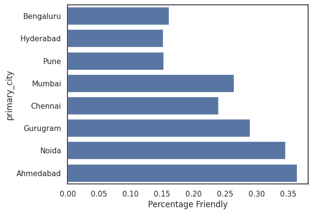
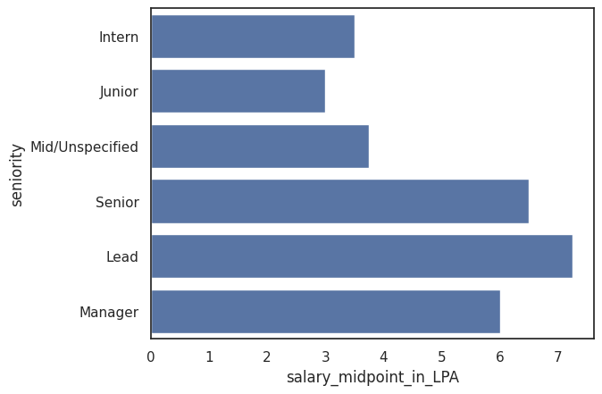
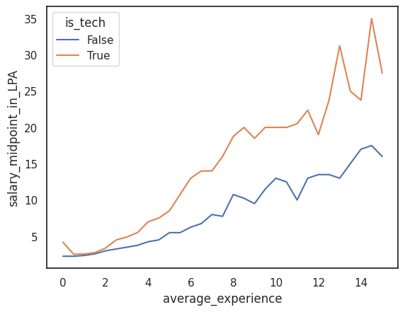
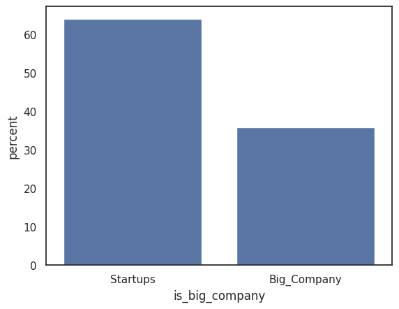
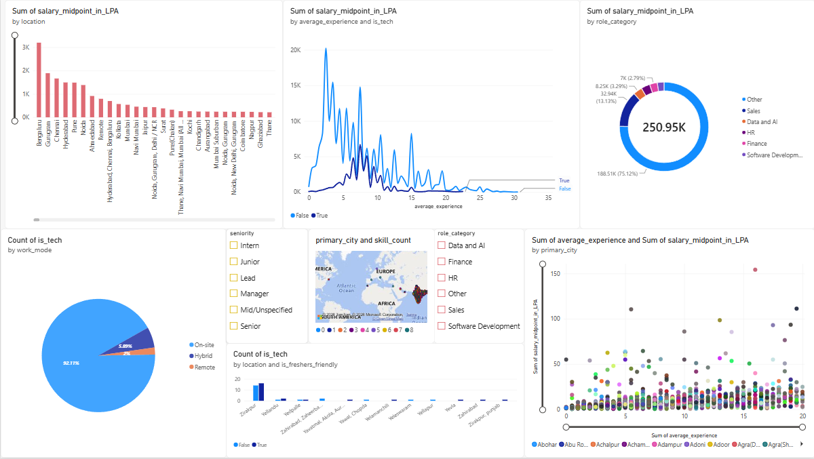

# Indian Job Market Analytics
**Data analytics mini-project | Team 4**

Exploratory analysis of Indian job postings to understand hiring demand, experience expectations, work modes, fresher-friendly opportunities, and advertised salary patterns.

> **Scope note:** Findings describe the dataset used in this notebook. They are not a complete census of the Indian job market and do not establish cause and effect.

## Project team
- Kajal Gunjal
- Kapil Gajanan Khondkar
- Keyur Ganorkar

## Questions explored
- Which role categories and seniority levels appear most often?
- How do opportunities vary across selected cities?
- What share of postings are labelled fresher-friendly, and how does it vary by city and work mode?
- How do disclosed salary midpoints vary by role, seniority, city, and experience?
- Are selected differences statistically significant in this dataset?

## Dataset
- **Source:** [Indian Job Market Dataset 2025–2026 on Kaggle](https://www.kaggle.com/datasets/shivamshrivastava21/indian-job-market-dataset-2025-2026)
- **File used:** `indian-job-market-dataset-2025.xlsx`
- **Original size reported:** 97,929 rows × 17 columns
- **After duplicate job IDs were removed:** 97,679 rows
- Most records use INR; a small number use USD. Salary comparisons are filtered to INR where specified.
- The dataset itself is not bundled here. Download it from the source and update the notebook's file path before running.

## Workflow
1. Load data and inspect schema, data types, missing values, and duplicates.
2. Remove duplicate records using `jobId`.
3. Clean text and derive features such as primary city, role category, salary midpoint, average experience, seniority, work mode, and fresher-friendly status.
4. Explore demand, location, seniority, salary, experience, employer concentration, and work mode using charts.
5. Run hypothesis tests at a 5% significance level (`α = 0.05`).
6. Summarise findings with practical caveats.

## Key findings

### Fresher-friendly share varies by city
The notebook reports Ahmedabad at about 36% and Noida at about 35%, while Bengaluru, Hyderabad, and Pune are around 15–16%. This percentage is not the same as total job volume: a city can have many jobs but a lower fresher-friendly share.



### Salary varies by seniority
Reported median salary midpoints are approximately 3.5 LPA for Intern, 3.0 for Junior, 3.8 for Mid/Unspecified, 6.5 for Senior, 7.2 for Lead, and 6.0 for Manager. Group sizes and role mix affect these comparisons; the Junior salary sample is comparatively small.



### Experience and salary tend to rise together
The notebook's scatter/line analysis suggests a positive association between experience and salary midpoint. This is a trend in the observed data, not a guarantee about an individual's salary.



### Hiring is spread across many employers
The notebook reports that companies with 100 or more postings account for around 36% of postings, while smaller recruiters account for around 64%. It identifies 88 companies in the 100+ posting group out of 18,624 companies.



### Power BI Dashboard 
Using the Dataset, created A Dashboard to show some insights.


## Hypothesis testing
The notebook uses a 95% confidence level and `α = 0.05`.

| Test | Question | Reported result | Interpretation |
|---|---|---|---|
| Two-proportion z-test | Does fresher-friendly share differ between tech and non-tech? | Tech 6.78%; non-tech 33.06%; p < 0.05 | Reject equal proportions for this dataset. |
| Two-sample t-test | Does mean disclosed INR salary differ between tech and non-tech? | Means about ₹14.53 LPA vs ₹6.88 LPA; p < 0.05 | Observed means differ; only usable disclosed INR salaries are included. |
| Chi-square | Is work mode associated with fresher-friendly status? | χ² ≈ 1240.34, df = 2, p < 0.05 | Evidence of association, not causation. |
| One-way ANOVA | Does salary midpoint differ across seniority groups? | F ≈ 142.15, p < 0.05 | At least one group mean differs; follow-up comparisons are needed. |
| One-sample proportion z-test | Does fresher-friendly share differ from 25%? | z ≈ 23.10, p < 0.05 | Observed share differs from the 25% benchmark. |

Notebook outputs may display p-values as `0.0` due to numerical formatting; this means extremely small reported values, not literally zero. Statistical significance does not by itself indicate practical importance.

## Tools
Python · pandas · NumPy · Matplotlib · Seaborn · SciPy · statsmodels · Jupyter Notebook / Google Colab

## Repository contents
```text
indian-job-market-analytics/
├── Mini_Project_Team4.ipynb
├── README.md
├── project_report.pdf
└── assets/
    ├── fresher_friendly_by_city.png
    ├── salary_by_seniority.png
    ├── salary_experience_tech.png
    └── big_company_share.png
    └── More Graphs  

```

## Run the notebook
1. Download the dataset from the Kaggle source above.
2. Place it in your preferred local/Drive folder.
3. Open `Mini_Project_Team4.ipynb` in Jupyter or Google Colab.
4. Update the file path in the data-loading cell.
5. Install packages if required:

```bash
pip install pandas numpy matplotlib seaborn scipy statsmodels openpyxl jupyter
```

6. Run cells from top to bottom. Some cells use Google Colab/Drive-specific paths and may need adjustment for local Jupyter.

## Limitations
- Results depend on dataset coverage, collection, and labelling.
- Salary analysis uses disclosed salary records and selected filters, not all postings.
- Salary outliers and group sizes can affect summaries.
- Role categories and fresher-friendly status are derived fields; conclusions depend on their definitions.
- Statistical tests identify differences or associations, not causes.
- Re-run the notebook end-to-end with a verified data path before treating every output as final.

## Conclusion
This project demonstrates a practical analytics workflow: data inspection and cleaning, feature engineering, exploratory visualisation, salary/hiring analysis, and hypothesis testing. Compare **job volume**, **fresher-friendly share**, and **salary** separately rather than treating any one measure as a complete picture of opportunity.

---

